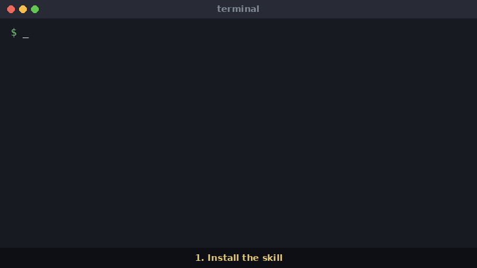

# reverse-engineer-any-video

**Give your agent the evidence to work out how any video was made, and which of a channel's videos actually beat its baseline.**

[](LICENSE)


[](#benchmark)

```bash
npx skills add lisn0/reverse-engineer-any-video
```

Then ask your agent: *"How was this video made? ./clip.mp4"*



<sub>Demo clip: a 30-second excerpt (3:20 to 3:50) of
[*Tears of Steel*](https://mango.blender.org/) (2012), © Blender Foundation, licensed
[CC BY 3.0](https://creativecommons.org/licenses/by/3.0/), from
[download.blender.org](https://download.blender.org/demo/movies/ToS/). The answer card is
condensed from that run's real measurements and contact sheet.</sub>

An Agent Skill plus two standalone Python scripts:

- **`evidence.py`** breaks down one video, a local file or any URL
  [yt-dlp](https://github.com/yt-dlp/yt-dlp) can download, into measurements: source
  facts, contact sheets, shot boundaries confirmed on source frames, pans and zooms,
  a timed transcript and audio readings. The model works from measurements instead of
  guessing from a few frames.
- **`scan_channel.py`** ranks a channel's videos against the channel's own baseline
  (views divided by the median of their neighbours), so the winners and flops you compare
  come from the same channel and format. Tested on TikTok and YouTube.

The skill then walks the agent through the investigation: competing hypotheses for each
part, fingerprints, web research, winners versus flops, a small rebuild test and a blind
review. Every claim is labelled measured, seen, blind, found, inferred or unknown.

## Contents

- [Install](#install)
- [Quickstart](#quickstart)
- [What you get](#what-you-get)
- [Benchmark](#benchmark)
- [Requirements](#requirements)
- [Known limits](#known-limits)
- [FAQ](#faq)

## Install

The skill is a standard [Agent Skills](https://agentskills.io) `SKILL.md` folder at
[`plugins/reverse-engineer-any-video/skills/reverse-engineer-any-video/`](plugins/reverse-engineer-any-video/skills/reverse-engineer-any-video/).

**Works with:** tested with Claude Code. Other agents that read Agent Skills (Codex,
Cursor, OpenCode and others supported by the Skills CLI) should load it the same way, but
haven't been tested yet.

| Route | Command |
|---|---|
| Skills CLI ([vercel-labs/skills](https://github.com/vercel-labs/skills)) | `npx skills add lisn0/reverse-engineer-any-video` |
| One agent only | `npx skills add lisn0/reverse-engineer-any-video -a claude-code` |
| Claude Code plugin | `/plugin marketplace add lisn0/reverse-engineer-any-video` then `/plugin install reverse-engineer-any-video@reverse-engineer-any-video` |
| By hand | copy the skill folder into `.claude/skills/` (Claude Code) or `.agents/skills/` (Codex) |

`npx skills add ... --list` shows the skill without installing it.

The skill runs the scripts for you, so the [requirements](#requirements) still need to be
on the machine the agent runs on:

```bash
brew install ffmpeg            # or: sudo apt install ffmpeg
pip install numpy yt-dlp
pip install faster-whisper     # optional, for transcripts
```

## Quickstart

Ask your agent in plain words:

- *"How was this video made: ./clip.mp4"*
- *"Reverse engineer this channel: https://www.youtube.com/@&lt;handle&gt;/shorts"*
- *"Which of this channel's videos beat its baseline, and what do they share?"*

Or run the scripts yourself. They live in
`plugins/reverse-engineer-any-video/skills/reverse-engineer-any-video/scripts/`; the paths
below are relative to the skill folder:

```bash
# One video: a local file or a URL
python3 scripts/evidence.py ./clip.mp4 --out runs/clip
python3 scripts/evidence.py "<video URL>" --out runs/<name>

# A channel: the YouTube /videos or /shorts tab, or a TikTok profile URL
python3 scripts/scan_channel.py "https://www.youtube.com/@<handle>/shorts" --out runs/<name>
```

Useful flags for `evidence.py`:

- `--no-transcript` skips Whisper (and the audio readings that depend on it).
- `--review-at SECONDS` (repeat up to eight times, with a new `--out`) writes dense
  frame-by-frame sheets around a disputed cut, flash or dissolve, plus `review.json`.
- `--crosscheck-cuts` adds a separate FFmpeg scene-score cue to compare against.

Run either script with `--help` for all options.

## What you get

### `evidence.py --out runs/clip`

```
runs/clip/
├── manifest.json     source facts, change counts, every sheet and each tile's time
├── changes.json      shots (cut / gradual), elements, text, small changes, motion
├── audio.json        loudness, beat, speech share, music / narrator / voice readings
├── transcript.txt    [seconds] text
├── words.json        word-level timings
└── sheets/           overview-01.jpg, hook-01.jpg, middle-01.jpg, ending-01.jpg, changes-01.jpg ...
```

A URL source also keeps `video.mp4` and `video.info.json`. `audio.json`, `transcript.txt`
and `words.json` are written only when the video has audio and transcripts are on.

Trimmed `manifest.json` (illustrative values):

```json
{
 "source": {"type": "local file"},
 "facts": {"width": 1080, "height": 1920, "fps": 30.0, "duration_s": 42.6,
           "picture_offset_s": 0.0, "bytes": 6815744, "kbps": 1280, "has_audio": true},
 "change_counts": {"shot": 11, "element": 7, "text": 19, "small": 4,
                   "estimated_shots": 12, "estimated_shots_if_elements_are_cuts": 19,
                   "motion_spans": 6, "uncertain_shots": 2},
 "words": 118,
 "sheets": {"hook": [{"sheet": "sheets/hook-01.jpg", "columns": 6,
                      "tile_times_s": [0.0, 0.17, 0.33, 0.5, 0.67, 0.83, "..."]}]}
}
```

Trimmed `changes.json`:

```json
{
 "events": [
  {"t": 2.433, "structure_change": 0.612, "view_kept": 0.104, "kind": "shot", "cue": "cut"},
  {"t": 3.1, "kind": "text", "changed": 0.041},
  {"t": 9.8, "kind": "shot", "changed": 0.38, "cue": "gradual", "view_kept": 0.31, "side_steadiness": 0.92}
 ],
 "uncertain_shots": [
  {"t": 17.2, "changed": 0.22, "view_kept": 0.88, "side_steadiness": 0.9,
   "why": "the view half a second either side still matches"}
 ],
 "motion_spans": [{"start": 4.0, "end": 6.5}],
 "picture_motion": [{"start": 4.0, "end": 5.0, "kind": "zoom", "scale": 1.06}]
}
```

Trimmed `audio.json`:

```json
{"duration_s": 42.6, "speech_share": 0.81, "words": 118, "beat_strength": 0.12, "beat_bpm": 96.0,
 "gap_silent_share": 0.94, "music": "no", "narrator": "yes", "voice_source": "generated_or_gated"}
```

`unclear` is a valid answer, and the skill tells the agent to report it as unknown.

### `scan_channel.py --out runs/<name>`

Writes `channel.json` (every video with views, format, age, baseline, ratio and label) and
`outliers.md`:

```markdown
# Channel scan: https://www.youtube.com/@<handle>/shorts

212 videos scored, 3 skipped (no views or known format). outlier: 14, normal: 161, flop: 22, too-new: 6, unscored: 9.

## Outliers

| vs baseline | views | format | video |
|---|---|---|---|
| 8.4x | 1,204,311 | short | [<video title>](<video URL>) |
| 5.1x | 733,090 | short | [<video title>](<video URL>) |

## Flops

| vs baseline | views | format | video |
|---|---|---|---|
| 0.21x | 30,118 | short | [<video title>](<video URL>) |
```

Short (3 minutes or less) and long videos get separate baselines. A video at 3x its
baseline or more is an outlier, at 0.5x or less a flop, and anything under 14 days old is
`too-new`, because it is still gaining views.

## Benchmark

Shot boundaries scored against the manually annotated BBC Planet Earth dataset (Baraldi,
Grana and Cucchiara): the first 180 seconds of five episodes, 87 reference boundaries.
Settings were tuned on two excerpts and frozen before the other three were scored once.

| Detector | All 5 excerpts (87) | Held-out 3 excerpts (53) |
|---|---:|---:|
| **This tool**, shots confirmed on source frames | **F1 96.0%** (85 matched, 5 false, 2 missed) | **F1 94.5%** |
| [Dissect](https://github.com/0xpratzyy/dissect), shot starts and internal cuts | | F1 94.4% |
| Dissect, shot starts only | | F1 89.1% |
| This tool's previous detector | | F1 67.1% |

On the held-out excerpts this ties Dissect with internal cuts, within one event; it
doesn't clearly beat it. Of the five held-out false positives, checked frame by frame, one
was a real cut missing from the reference and four were motion or light changes inside one
view.

[benchmark/README.md](benchmark/README.md) has the full method, hand-labelled method
questions, audio and motion tests, runtimes and the scoring scripts. Some benchmark
scripts need extra packages (soundfile and kokoro for `make_ai_case.py`; opencv and pillow
for the Dissect comparison).

## Requirements

- Python 3.10 or newer, with numpy
- [ffmpeg](https://ffmpeg.org/) and `ffprobe` on your `PATH`
- [yt-dlp](https://github.com/yt-dlp/yt-dlp) for URLs and channel scans
- Optional: [faster-whisper](https://github.com/SYSTRAN/faster-whisper) for transcripts
  (runs on CPU; skip it with `--no-transcript`)

No GPU and no API key. Everything runs locally. The network is used only by yt-dlp for
URLs, and by faster-whisper to fetch its model the first time.

To work on the repo itself:

```bash
git clone https://github.com/lisn0/reverse-engineer-any-video.git
cd reverse-engineer-any-video
python3 -m venv .venv && . .venv/bin/activate
pip install -r requirements.txt
python3 -m unittest discover tests
```

## Known limits

- Large motion or lighting changes inside one view (a subject passing a fixed camera, a
  flare blocked for a frame) can still be counted as a new shot.
- A slow fade to black can be missed, because the picture keeps its shape as it darkens.
- The shot pass decodes every frame: about 8.7 s to 20.8 s for a 3-minute clip in our
  timings. No true 4K file has been timed.
- The benchmark covers a handful of videos and one agent model, and most test videos were
  made by code. It doesn't support a general accuracy claim.
- Channel scans are tested on TikTok and YouTube only. Other sites yt-dlp can list may
  work but are untested.
- Tested with Claude Code only.
- Status v0.1: scanning is built and measuring is partly built. Automated compare,
  reconstruct, verify and blueprint steps are designed but not built
  ([design](docs/DESIGN.md), [roadmap](docs/ROADMAP.md)); for now the agent does them by
  following the skill.

## FAQ

**How do I make Claude (or another agent) understand a video?** Agents can't watch video.
This skill turns a video into contact sheets with exact tile times, a cut list, motion
readings, a timed transcript and audio readings the agent can read and reason about.

**Does it need a GPU or an API key?** No. ffmpeg, numpy and optionally faster-whisper on
CPU.

**Which sites does it support?** Any local file, and any URL yt-dlp can download. The
channel scan is tested on YouTube and TikTok.

**How is this different from PySceneDetect or FFmpeg's scene filter?** Those find cuts.
This also labels what changed (shot, added element, text, small pop-in), confirms each
shot on source frames and separates hard cuts from dissolves, measures pans and zooms and
reads the audio, then hands it all to an agent with an investigation method.

**Does it download or copy videos?** For URLs it downloads one copy into your `--out`
folder to measure it. The skill's rules say to study the format, not to reproduce a
script, footage or a likeness.

**Why does a scanner flag "third-party content exposure"?** The skill reads text other
people wrote: titles, descriptions and transcripts. Someone could hide instructions in
them (indirect prompt injection). The skill tells the agent to treat all of that as
untrusted data and never follow it. `manifest.json` keeps the title and channel name in a
separate `untrusted_source_text` block and leaves the description out unless you pass
`--include-description` (then capped at 1,000 characters). The scripts
only measure files; they don't run anything a video contains.

## Credits

[Dissect](https://github.com/0xpratzyy/dissect) (MIT) is the comparison baseline in the
benchmark; `bench/run_dissect.sh` runs a pinned revision of it. Several ideas here, such
as measured placeholders and transition strips, come from it. Nothing from Dissect runs
inside this tool or is copied into it.

## License

[MIT](LICENSE)
